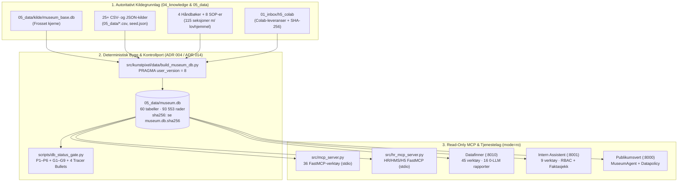

# Dataoversikt (`museum.db`) og MCP-koblinger i Kunstpixel

> **Tilbake til hovedportalen:** [KUNNSKAPSKART.md](../KUNNSKAPSKART.md) · **Agentregler:** [AGENTS.md](../AGENTS.md) · **Begrepsordliste:** [00_felles/ordliste.yaml](../00_felles/ordliste.yaml)

Denne filen gir den komplette oversikten over alle **60 brukertabeller** (`93 553` brukerrader, skjemaversjon 9) i `05_data/museum.db`, alle **MCP- og HTTP-endepunkter**, **Tracer Bullets** (`P4a`–`P4d`), **bevisste syntetiske kontrollcaser**, og **de 4 morgensløyfe-agentene** (`ADR 014`).

---

## 1. Arkitekturkart: Fra Kildedata til MCP og Agenter

---

## 2. Komplett Tabelloversikt (`05_data/museum.db` — 56 tabeller)

### 2.1 Domene 1: HR, Vaktplan, Tariff & Arbeidsmiljø (22 tabeller · 60 292 rader)

| Tabell | Rader | PK / Nøkkel | FK | Kilde / Beskrivelse |
| :--- | ---: | :--- | ---: | :--- |
| **`hr_vakter`** | 54 994 | `vakt_id` | 2 | Vakter `2010-01-01`–`2026-12-31` for `122` ansatte (`arkiv_hr_vakt_klokkeslett.csv` + `justering.csv`) |
| **`hr_fravaer`** | 3 456 | `fravaer_id` | 1 | Egenmeldt og legemeldt fravær, ferie og permisjon (`arkiv_hr_fravaer.csv`) |
| **`org_ansatt_kompetanse`** | 596 | `ansatt_id, skill_code` | 2 | Kompetansebevis med utløpsdato normalisert mot `hr_ansatte` (`mock_ansatt_kompetanser.csv`) |
| **`hr_innleie`** | 318 | `innleie_id` | 2 | Innleiekontrakter 2010–2026 med `doffin_referanse`, timepris og `godkjent_av_ansatt_id` |
| **`hr_ansatte`** | 168 | `ansatt_id` | 1 | Hovedregister over nåværende og tidligere ansatte (`KP-ANS-001`–`KP-ANS-168`), knyttet til `styrk08_katalog` |
| **`personas`** | 168 | `ansatt_id` | 0 | Dype CV-profiler med utdanning, erfaring og publikasjoner (`arkiv_cv_personas.json`) |
| **`hr_personalmapper`** | 167 | `saksnr` | 1 | Fortrolige personalsaker (`gradering = LEDER_FORTROLIG`). **`KP-ANS-155` mangler med vilje** (låst testcase) |
| **`hr_medarbeidersamtaler`** | 142 | `samtale_id` | 1 | Medarbeidersamtaler (`arkiv_hr_medarbeidersamtaler.csv`). `2` nåværende ansatte står uten samtale (mangelcase). Ingen av de 94 som har sluttet har samtale |
| **`virke_tariff`** | 67 | `lonnstrinn` | 0 | Virke Landsoverenskomst lønnstrinn `20–86` med ordinær-, kvelds-, helge- og helligdagssats |
| **`interne_henvendelser`** | 60 | `henvendelse_id` | 1 | Interne HR/HMS-spørsmål fra ansatte (`mock_interne_henvendelser.csv`) |
| **`hr_person_skill`** | 30 | `person_id, skill_code` | 2 | Kompetansekobling for HR-demokjernen (`05_data/hr_demo/seed.json`) |
| **`hr_innleide_kompetanse`** | 19 | `innleid_id, skill_code` | 2 | Sertifiseringer for innleide konsulenter/vektere (`arkiv_hr_innleide_kompetanse.csv`) |
| **`hr_opplaering_onboarding`** | 18 | `opplaering_id` | 0 | Onboarding-løp og obligatoriske kurs per rolle (`hr_opplaering_onboarding.csv`) |
| **`org_ferdigheter`** | 14 | `skill_code` | 0 | Kompetansekatalog for hele organisasjonen (`mock_interne_ferdigheter.csv`) |
| **`stasjon_krav`** | 13 | `stasjon, skill_code` | 1 | Obligatoriske ferdighetskrav per vaktstasjon (`stasjon_krav.csv`, brukes av `core/bemanning.py`) |
| **`hr_people`** | 12 | `id` | 1 | Demopersoner (`E101`–`E112`) koblet til `hr_ansatte(ansatt_id)` |
| **`hr_availability`** | 11 | `person_id, work_date...` | 1 | Tilgjengelighet i HR-demokjernen (`seed.json`) |
| **`styrk08_katalog`** | 10 | `styrk_kode` | 0 | Offisielle SSB STYRK-08 yrkeskoder og minste lønnstrinn |
| **`hr_innleide_personer`** | 8 | `innleid_id` | 0 | Navngitte innleide spesialister og vektere (`arkiv_hr_innleide_personer.csv`) |
| **`hr_rules`** | 8 | `id` | 0 | Strukturerte HR-, HMS- og kvalitetsregler i demokjernen (`seed.json`) |
| **`arbeidstid_grenser`** | 6 | `navn` | 0 | Lovfestede grenser etter AML kap. 10 (`dognmaks = 9t`, `ukemaks = 40t`, `hviletid = 11t`) |

### 2.2 Domene 2: Publikum, Kafé & Besøk (6 tabeller · 23 322 rader)

| Tabell | Rader | PK / Nøkkel | FK | Kilde / Beskrivelse |
| :--- | ---: | :--- | ---: | :--- |
| **`kafe_varesalg`** | 15 024 | `salg_id` | 1 | Daglig varesalg i museumskaféen knyttet til `kafe_meny` (`kafe_varesalg.csv`) |
| **`dagsbesok`** | 6 209 | `dato` | 0 | Daglige besøkstall og billettinntekter `2010-01-01`–`2026-12-31` |
| **`anmeldelser`** | 2 169 | `anmeldelse_id` | 1 | Publikumsanmeldelser fra Google (`1 400`), egen undersøkelse (`435`) og TripAdvisor (`334`) |
| **`besok_tilfredshet`** | 939 | `maaling_id` | 0 | Tilfredshetsmålinger og NPS-score (`besok_tilfredshet.csv`) |
| **`kafe_meny`** | 16 | `produkt_id` | 0 | Kafémeny med priser, MVA-sats og lovpålagte allergener (`kafe_meny.csv`) |
| **`publikum_faq`** | 12 | `id` | 0 | Autoritative svar på åpningstider, billetter, garderobe og tilgjengelighet |

### 2.3 Domene 3: Samling, Kunstnere & Utstillinger (10 tabeller · 367 rader)

| Tabell | Rader | PK / Nøkkel | FK | Kilde / Beskrivelse |
| :--- | ---: | :--- | ---: | :--- |
| **`utstillinger_historikk`** | 102 | `utstilling_id` | 0 | 17 års utstillingshistorikk (`2010–2026`) med `2 141 837` besøkende totalt |
| **`utstilling_okonomi`** | 102 | `utstilling_id` | 1 | Budsjett, innleie, billett-/kataloginntekter, sponsorstøtte og netto resultat |
| **`utstillingsinnlan`** | 50 | `innlan_id` | 1 | Innhentede kunstlån fra Nasjonalmuseet, KODE m.fl. med forsikringsverdi og kurerkrav |
| **`hendelser`** | 45 | `id` | 1 | Omvisninger, verksteder, foredrag og arrangementer ut `2026-12-31` |
| **`verk`** | 16 | `id` | 2 | Kjerneverk i samlingen med proveniens, veggtekst, audioguide og barneformidling |
| **`tilstandsrapporter`** | 16 | `rapport_id` | 1 | Tilstandsgrad (`TG 1–4`), maks luks (`50/200`), RH-krav og forsikringsverdi per verk |
| **`utstilling_verk`** | 15 | `utstilling_id, verk_id` | 2 | Koblingstabell mellom aktive utstillinger, verk og salplassering |
| **`kunstnere`** | 12 | `id` | 0 | Kunstnerregister med nasjonalitet, levetid og biografi |
| **`saler`** | 6 | `id` | 0 | Sal A–E og museumskafé med etasje, kapasitet og klimakontroll |
| **`utstillinger`** | 3 | `id` | 0 | Aktive og kommende hovedutstillinger |

### 2.4 Domene 4: HMS, Styring, Håndbøker & Myndigheter (14 tabeller · 361 rader)

| Tabell | Rader | PK / Nøkkel | FK | Kilde / Beskrivelse |
| :--- | ---: | :--- | ---: | :--- |
| **`handbok_oppslag`** | 115 | `punkt_id` | 0 | **85** håndbokseksjoner (`PERSONAL` 27, `HMS_SIKKERHET` 21, `LEDER_BEREDSKAP` 20, `DRIFT_KVALITET` 17) + **30** SOP-punkter (`RUTINER_SOP`) |
| **`hms_avvik_tekst`** | 40 | `avvik_id` | 0 | Tekstlige HMS-avvik og strakstiltak (`mock_avvik_hms_tekst.csv`) |
| **`avvik_hms_drift`** | 34 | `avvik_id` | 3 | Strukturerte avvik (`HMS`, `SIKKERHET`, `KLIMA`, `TEKNISK`, `PUBLIKUM`) med `GRØNN`/`GUL`/`RØD` |
| **`rolle_sporsmal`** | 31 | `rolle_kode, sporsmal_id` | 1 | Fastlåste 0-LLM spørsmål per leder-/fagrolle (`rolle_sporsmal.csv`) |
| **`rapport_regler`** | 27 | `id` | 0 | Vurderingsregler og terskelverdier for deterministiske rapporter (`rapport_regler.csv`) |
| **`h5_rapportmaler`** | 21 | `id, felt_rekkefolge` | 0 | Obligatoriske rapportmaler med felter og datakilder (`h5_rapportmaler.csv`) |
| **`h5_arbeidsoppgaver_tidsbruk`** | 19 | `id` | 1 | Årsverk, timer per år og automatiseringspotensial per oppgave (`h5_arbeidsoppgaver_tidsbruk.csv`) |
| **`h5_historikk_2010_2026`** | 17 | `ar` | 0 | Komplett 17-års nøkkeltallsserie (`2010–2026`) for besøk, økonomi, HMS, RUH og tilsyn. `besok_totalt`, `billettinntekter_tkr`, `kafeinntekter_tkr`, `inntekter_totalt_tkr`, `kostnader_tkr`, `resultat_tkr` og `ansatte_arsverk` regnes i bygget fra `driftsregnskap`, `dagsbesok` og `hr_vakter` (Lars 2026-11-22: vaktene og dagsdataene er fasit) |
| **`driftsregnskap`** | 2 609 | `maaned, konto` | 0 | Syntetisk driftsregnskap per måned `2010-01`–`2026-12`, 13 kontoer etter NS 4102. Lønn (5000) = vaktlønn, billett (3000) = `dagsbesok`, kafé (3100) = `kafe_varesalg` fra 2024 og h5 før det (`driftsregnskap.csv`, `regnskap_builder.py`) |
| **`driftsmeldinger_epost`** | 3 889 | `melding_id` | 3 | Daglige drifts-, kunde- og arrangementsmeldinger/e-post/SMS (2010–2026, 82,0 % i 2020–2026) (`arkiv_driftsmeldinger_2010_2026.csv`) |
| **`driftsmeldinger_tiltak`** | 3 889 | `tiltak_id` | 2 | Triage, lov-/SOP-treff og forslag til svarutkast koblet til `driftsmeldinger_epost` (`arkiv_driftsmeldinger_tiltak.csv`) |
| **`roller`** | 15 | `kode` | 0 | Rolledefinisjoner og triggere for Datafinner og Intern Assistent (`roller.csv`) |
| **`h5_rapporteringskalender`** | 12 | `id` | 0 | Årshjul for lovpålagt og intern rapportering (`h5_rapporteringskalender.csv`) |
| **`hms_ergonomi_rotasjon`** | 9 | `stasjon_id` | 1 | STAMI-baserte krav til sammenhengende ståtid, sittepause og rullering |
| **`h5_myndighetskontakter`** | 8 | `id` | 0 | Tilsynsmyndigheter, kontaktpersoner og dokumentasjonskrav (`h5_myndighetskontakter.csv`) |
| **`arbeidstilsynet_renhold`** | 7 | `orgnr` | 0 | Godkjentstatus i Arbeidstilsynets Renholdsregister |
| **`h5_tilsynsbesok_rutine`** | 6 | `steg_nr` | 0 | 6-trinns prosedyre ved tilsynsbesøk med frister for gule og røde avvik |

### 2.5 Domene 5: Offentlige Registre & Metadata (4 tabeller · 320 rader)

| Tabell | Rader | PK / Nøkkel | FK | Kilde / Beskrivelse |
| :--- | ---: | :--- | ---: | :--- |
| **`norske_helligdager`** | 237 | `dato` | 0 | Norske bevegelige og faste helligdager `2010–2026` (133 % helligdagstillegg) |
| **`ssb_sykefraver_kultur`** | 68 | `periode` | 0 | Kvartalsvis sykefravær i kultursektoren `2010-Q1`–`2026-Q4` (SSB tabell 12441) |
| **`leverandor_enhetsregister`** | 12 | `orgnr` | 0 | Brønnøysundregistrene-oppslag (MVA-registrering, ansatte, konkursstatus) |
| **`sqlite_sequence`** | 3 | `name` | 0 | Intern SQLite sekvenstabell |

---

## 3. Låste Tracer Bullets og Bevisste Kontrollcaser

| Kode | Kontrollnavn | Fasitverdi i `museum.db` | Voktes av |
| :--- | :--- | :--- | :--- |
| **`P4a`** | Tracer vakt | `2026-11-13` -> `VAKT-0054561` (`Hilde Viken`, `7,5` t) | `scripts/db_status_gate.py` |
| **`P4b`** | Tracer utstillingsøkonomi | `KP-EXH-2026-FOKUS-2` -> `netto_resultat_nok = 657 556` kr | `scripts/db_status_gate.py` |
| **`P4c`** | Tracer sykefravær | `2026-Q4` -> `6,2 %` | `scripts/db_status_gate.py` |
| **`P4d`** | Tracer lønnskostnad (m/ kveldssats) | `2026-11` -> Drift `115 273,75`, Formidling `405 059,41`, Marked `197 770,70`, Samling `64 110,19` | `scripts/db_status_gate.py` |
| **`CASE-TOM`** | Tom personalmappe (`KP-ANS-155`) | `Stine Haugen` (`KP-ANS-155`) skal ha **eksakt 0 rader** i `hr_personalmapper` | `tests/test_hr_case_discovery.py` |
| **`P6-HVILE`** | Kort hviletid mellom vakter (`< 11t`) | **7 kjente brudd** (ingen nye tillatt) — syntetisk revisjonsgrunnlag | `scripts/db_status_gate.py` |
| **`P6-DOGN`** | Vakter over døgnmaks (`> 9t`) | **1 287 kjente vakter** (f.eks. `VAKT-0000005`) — syntetisk overtids-/revisjonsgrunnlag | `scripts/db_status_gate.py` |

---

## 4. Komplett MCP-verktøykatalog (`src/mcp_server.py` — 36 verktøy)

### 4.1 Samling & Publikumsvert (5 verktøy)
1. `search_collection(query, artist, title, technique, theme, room_id, limit)` — Søk i kunstverk på tvers av saler og temaer.
2. `get_artwork_details(artwork_id)` — Henter verkskort, proveniens, veggtekst og audioguide.
3. `get_room_artworks(room_id)` — Verk utstilt i valgt sal i kuratert rekkefølge.
4. `search_events(event_type, date_from, date_to, limit)` — Omvisninger, verksteder og arrangementer.
5. `search_faq(query, category)` — Autoritative svar fra `publikum_faq`.

### 4.2 Arkiv, Direktør & Drift (3 verktøy)
6. `search_archive_exhibitions(query, year_from, year_to, curator, limit)` — Søk i `utstillinger_historikk` (`2010–2026`).
7. `search_contractors(kategori, leverandor, aar, limit)` — Søk i `hr_innleie` (scenografi, Securitas, konservering, transport).
8. `get_employee_cv(ident)` — Henter dybde-CV fra `personas` og `hr_ansatte`.

### 4.3 Konsoliderte Operative Verktøy (6 verktøy)
9. `get_condition_report(artwork_id)` — Tilstandsgrad (`TG 1–4`), luks, RH og forsikringsverdi fra `tilstandsrapporter`.
10. `search_loans(exhibition_id, query, limit)` — Søk i 50 kunstlån i `utstillingsinnlan`.
11. `get_exhibition_economy(exhibition_id)` — Prosjektregnskap fra `utstilling_okonomi`.
12. `search_incidents(kategori, alvorlighetsgrad, sal_id, limit)` — Avvikslogg fra `avvik_hms_drift`.
13. `verify_supplier_brreg(orgnr_or_name)` — Enhetsregister- og MVA-sjekk fra `leverandor_enhetsregister`.
14. `calculate_shift_cost(lonnstrinn, timer, er_kveld, er_helg, er_helligdag)` — Tarifforakel mot `virke_tariff`.

### 4.4 HR, HMS & Kvalitet (14 verktøy)
15. `count_documented_skill(code, as_of)` — Teller aktive ansatte med gyldig kompetansebevis.
16. `propose_kiosk_staffing(work_date, start, end, need)` — Rangerer skiftkandidater deterministisk.
17. `lookup_hr_hms_quality_rules(domain, topic, as_of)` — Slår opp i `hr_rules`.
18. `get_competence_catalog()` — Returnerer kompetansekatalogen (`org_ferdigheter`, 14 koder).
19. `get_staff_member(person_id, as_of)` — Ansattkort med kompetanser og tilgjengelighet.
20. `evaluate_kiosk_proposal(suggested_ids, work_date, need)` — Sjekker bemanningsforslag mot KI-feller (`L01–L03`).
21. `audit_shift_compliance(ansatt_id, dato, start, end)` — Reviderer vakt mot `arbeidstid_grenser` (`AML kap. 10`).
22. `check_cleaning_supplier_approval(orgnr)` — Sjekker `arbeidstilsynet_renhold`.
23. `get_job_profile_styrk(kode_or_stilling)` — Slår opp i `styrk08_katalog`.
24. `get_calendar_holiday_info(dato)` — Slår opp i `norske_helligdager`.
25. `get_ergonomic_rotation_rules(sal_or_station_id)` — Slår opp i `hms_ergonomi_rotasjon`.
26. `get_sickness_absence_statistics(year, quarter)` — Slår opp i `ssb_sykefraver_kultur`.
27. `search_hms_guidance(query, topic, limit)` — Søker i 344 nasjonale HMS-veiledningspunkter ([04_knowledge/01_governance/hms_veiledning_nasjonal.yaml](01_governance/hms_veiledning_nasjonal.yaml)).
28. `lookup_handbook(query, handbok, role, limit)` — Søker i alle 115 punkter i `handbok_oppslag` (4 håndbøker + 8 SOP-er).

### 4.5 Styring, Tilsyn, Rapportering & Arbeidsoppgaver (5 H5-verktøy)
29. `lookup_authority_contacts(query, myndighet_id)` — Oppslag i `h5_myndighetskontakter` og `h5_tilsynsbesok_rutine`.
30. `get_reporting_calendar(query, frekvens)` — Oppslag i `h5_rapporteringskalender`.
31. `get_report_template(mal_id)` — Oppslag i `h5_rapportmaler`.
32. `search_work_tasks_and_hours(query, rolle_id, kategori)` — Oppslag i `h5_arbeidsoppgaver_tidsbruk`.
33. `get_governance_history(query, kategori, periode)` — Oppslag i `h5_historikk_2010_2026`.
33a. `get_operating_accounts(aar, maaned, konto)` — Driftsregnskapet per måned (`driftsregnskap`) med sum inntekter, sum kostnader og resultat. Kun MCP, ikke i Datafinner.
34. `get_daily_ops_inbox(dato, fra_dato, til_dato, aar, kategori, hastegrad, status, mottaker_rolle, vurdering_utfall, sok, limit)` — Daglig driftsinnboks (`driftsmeldinger_epost` + `driftsmeldinger_tiltak`).

### 4.6 Kart & Colab-leveranser (3 verktøy)
34. `get_building_map_data(etasje, sone_type)` — Bygningsmodell og soner fra `06_kart`.
35. `list_colab_inbox_deliveries()` — Lister leveranser i `01_inbox/incoming`.
36. `verify_colab_dataset(delivery_name)` — Verifiserer SHA-256 for Colab-leveranser.

*(I tillegg eksponerer `src/kunstpixel/adapters/datafinner.py` totalt **45 hvitelistede verktøy** inkl. `discover_hr_cases`, `investigate_hr_case`, `propose_shift_swap`, `lookup_onboarding`, `query_cafe_sales` og `query_reviews`.)*

---

## 5. De 4 Morgensløyfe-agentene ([ADR 014](04_domain/decisions/ADR_014_morgensloyfe_informasjonsjeger_og_funnkontroll.md))

| Klokkeslett | Sidecar-ID | Rolle | Kjernekommando | Done-kriterium |
| :--- | :--- | :--- | :--- | :--- |
| **`09:00`** | `kunstpixel-colab-mcp` | **Informasjonsjeger & Prosedyrebygger** | `py -3.13 scripts/informasjonsjeger_kontroll.py --finn-hull` | `0` lovhjemmel-/prosedyrehull i `handbok_oppslag` (`115` punkter) og `test_handbook_compliance.py` `100 %` grønn |
| **`09:15`** | `kunstpixel-data-builder` | **Kontrollport, Colab-synk & Databygger** | `py -3.13 scripts/informasjonsjeger_kontroll.py --kontroller` | Pytest grønn (auto-rollback ved feil), `museum.db` nybygd (`LIK`), `db_status_gate.py` `0 feil`, Colab synket |
| **`09:30`** | `kunstpixel-engine-builder` | **Motor- og Funksjonsbygger** | `powershell -File scripts/pixel_bygger.ps1` | Kjernetester grønne (`test_mvp_bemanning.py`, `test_mvp_oppslag.py`) og logget i `.scratch/bygger-fremdrift.md` |
| **`09:45`** | `kunstpixel-sentinel` | **Systeminspektør & Fornuftsvakt** | `db_inspect.py --db 05_data/museum.db --output .scratch/db-status/INSPEKSJON-SISTE.md` | Fersk Mermaid ERD i `INSPEKSJON-SISTE.md` og alle 4 Tracer Bullets (`P4a`–`P4d`) `[OK]` |
