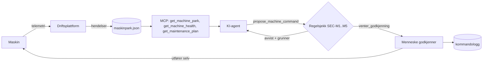

# Maskinparken – produktark

> Generert av `06_kart/produktark_builder.py` fra `06_kart/maskinpark.json`. Ikke rediger for hånd.

Ett ark per maskintype. Hvert ark viser hvor enhetene står, hvilke data de sender, hvordan du følger dem og hvilke kommandoer KI-en kan foreslå. Reglene og skillen står i `.claude/skills/maskinpark/SKILL.md`.

## Dataflyten

## Kunst fra sal til magasin

1. `hengerobot` tar ned verket i salen (`ta_ned_verk`) med konservator til stede.
2. `hengerobot` legger verket i en `kunstkasse` (`pakk_verk`).
3. `kunstkasse` kjører selv til magasinet via vareheisen i kunstmodus (`kjor_kasse_til_magasin`), med to personer ved S4.

Alt skjer utenom åpningstid, og hvert steg er et eget forslag som må godkjennes.

## Alle typer

| Produkt | Kategori | Antall | KI-tilgang | Ark |
|---|---|---|---|---|
| Dampbefukter | Bygningsanlegg | 1 | `foresla` | [befukter](befukter.md) |
| Kjølemaskin | Bygningsanlegg | 1 | `foresla` | [kjolemaskin](kjolemaskin.md) |
| Klimastyring per sone | Bygningsanlegg | 3 | `foresla` | [klimastyring](klimastyring.md) |
| Ladestasjoner | Bygningsanlegg | 1 | `foresla` | [lading](lading.md) |
| Lysstyring (DALI) | Bygningsanlegg | 5 | `foresla` | [lysstyring](lysstyring.md) |
| Ventilasjonsaggregat | Bygningsanlegg | 1 | `foresla` | [ventilasjon](ventilasjon.md) |
| Publikumsheis | Heiser | 1 | `foresla` | [publikumsheis](publikumsheis.md) |
| Vare- og kunstheis | Heiser | 1 | `foresla` | [vareheis](vareheis.md) |
| Hengerobot for bildebytte | Roboter | 1 | `foresla` | [hengerobot](hengerobot.md) |
| Selvkjørende kunstkasse | Roboter | 2 | `foresla` | [kunstkasse](kunstkasse.md) |
| Renholdsrobot | Roboter | 4 | `foresla` | [renholdsrobot](renholdsrobot.md) |
| Transportrobot | Roboter | 2 | `foresla` | [transportrobot](transportrobot.md) |
| Vaktrobot | Roboter | 2 | `foresla` | [vaktrobot](vaktrobot.md) |
| GPU-node for KI | KI-servere | 4 | `foresla` | [gpu_node](gpu_node.md) |
| Kjøleenhet i rad | KI-servere | 1 | `foresla` | [kjoler](kjoler.md) |
| Lagringsserver | KI-servere | 1 | `foresla` | [lagring](lagring.md) |
| Nettverkskjerne og brannmur | KI-servere | 1 | `les` | [nettverk](nettverk.md) |
| UPS (avbruddsfri strøm) | KI-servere | 1 | `foresla` | [ups](ups.md) |
| Adgangskontroll | Sikkerhet | 1 | `les` | [adgangskontroll](adgangskontroll.md) |
| Brannsentral | Sikkerhet | 1 | `les` | [brannsentral](brannsentral.md) |
| Kameraovervåking (CCTV) | Sikkerhet | 1 | `les` | [cctv](cctv.md) |
| Inergen-slokkeanlegg | Sikkerhet | 4 | `les` | [inergen](inergen.md) |

Totalt 40 maskiner av 22 typer.
