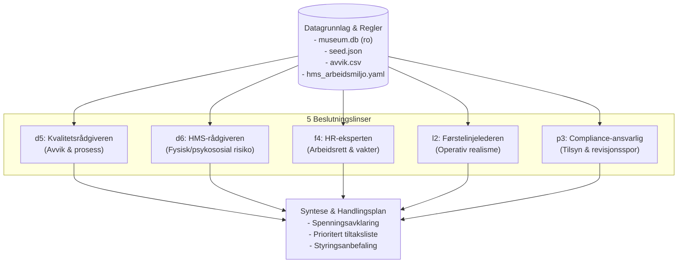

# Masterinstruks: Revisjonsteam for Kvalitet, HMS og Internkontroll

Dette rammeverket styrer hvordan de fem linse-agentene (`d5`, `d6`, `f4`, `l2`, `p3`) samlet gjennomfører en grundig, flerdimensjonal revisjon av Kunstpixels datagrunnlag, styringssystemer, bemanning og KI-beslutningsstøtte.



---

## De 5 Linse-agentene i Teamet

1. **[`01_kvalitetsradgiveren_d5.md`](file:///g:/Min%20disk/Kunstpixel/04_knowledge/05_linser/01_kvalitetsradgiveren_d5.md):** Fanger opp avvik, sjekker om rutiner etterleves og kvalitetssikrer prosessene.
2. **[`02_hms_radgiveren_d6.md`](file:///g:/Min%20disk/Kunstpixel/04_knowledge/05_linser/02_hms_radgiveren_d6.md):** Sikrer vernetjeneste, ergonomi, løftegrenser og vern mot alenearbeid.
3. **[`03_hr_eksperten_f4.md`](file:///g:/Min%20disk/Kunstpixel/04_knowledge/05_linser/03_hr_eksperten_f4.md):** Overvåker arbeidsrett, AML-arbeidstid (13t/24t vaktavvik), kompetansekrav og innleie.
4. **[`04_forstelinjelederen_l2.md`](file:///g:/Min%20disk/Kunstpixel/04_knowledge/05_linser/04_forstelinjelederen_l2.md):** Vurderer operativ realisme, kasse-/kaféhverdag, pauseavvikling og risikable snarveier.
5. **[`05_compliance_ansvarlig_p3.md`](file:///g:/Min%20disk/Kunstpixel/04_knowledge/05_linser/05_compliance_ansvarlig_p3.md):** Påser at internkontrollen holder mål overfor Arbeidstilsynet, Mattilsynet, DSB og kommunen.

---

## Arbeidsprosess: 4-Trinns Revisjonssløyfe

### Trinn 1: Deterministisk Datainnhenting (Indre Sløyfe – 0 Tokens)
Før noen av agentene resonnerer, hentes de harde fakta ut via CLI og skript:
```powershell
# 1. Hent autoritative bemanningskandidater for referanseskift
py -3.13 src/hr_cli.py kiosk --need 5

# 2. Hent alle 8 gjeldende regler
py -3.13 src/hr_cli.py rules

# 3. Inspiser kompetansekatalog og aktive ansatte
py -3.13 src/hr_cli.py skills
py -3.13 src/hr_cli.py people --active-only

# 4. Verifiser systemimmutabilitet og teststatus
powershell -NoProfile -ExecutionPolicy Bypass -File scripts/verify.ps1 -Mode manual
```

### Trinn 2: Separat Linsevurdering (Ytre Sløyfe)
Hver agent vurderer dataene strengt gjennom sitt definerte fagperspektiv og besvarer sine tre kjernespørsmål. Ingen agent får uttale seg utenfor eget mandat.

### Trinn 3: Spenningsanalyse (Konfliktavklaring)
Revisjonsteamet identifiserer hvor linsene kolliderer:
- **AML-krav (f4) vs. Operativ bemanningskrise (l2):** Hva gjør førstelinjen når lovpålagt hviletid kolliderer med udekket vaktbehov?
- **HMS-begrensninger (d6) vs. Driftsbudsjett (f4/l2):** Hvor oppstår fristelsen til å bryte forbudet mot alenearbeid eller tillate tunge løft uten assistanse?
- **Avviksføring (d5) vs. Frykt for tilsynspålegg (p3):** Oppmuntrer kulturen til åpen rapportering, eller feies nestenulykker under teppet?

### Trinn 4: Samlet Syntese og Beslutningsgrunnlag
Levere en strukturert rapport med:
1. **Faktagrunnlag:** Bekreftede orakelsvar og avvikstall.
2. **Hovedfunn per linse:** 2–3 konkrete observasjoner per agent.
3. **Identifiserte spenninger:** De mest kritiske interessekonfliktene.
4. **Anbefalt handlingsplan:** Konkrete, prioriterte tiltak for å heve kvaliteten.

---

## Sikkerhet & Kildehierarki
- **Urokkelig kildehierarki:** Lov og forskrift (AML, Internkontrollforskriften) trumfer interne retningslinjer; interne retningslinjer trumfer syntetiske demo-scenarier.
- **Skrivebeskyttelse:** All analyse skjer mot read-only kilder. Ingen data endres under analysen.

## Done-Når Kriterier
1. [ ] Alle 5 linser har gjennomført sin vurdering basert på deterministiske datauttrekk.
2. [ ] Minst to reelle spenningspunkter mellom drift og regelverk er belyst og drøftet.
3. [ ] Sluttleveransen inneholder en prioritert tiltaksliste forbedret for revisjon og tilsyn.
