# Datakart og Relasjonsindeks for Kunstpixel (`05_data/index.md`)

> **Formål:** Denne filen forklarer KI-agenter, subagenter og LLM-arbeidsflyter nøyaktig hvordan datasettet i Kunstpixel er strukturert, hvordan tabellene henger sammen, hvilke ID-standarder som gjelder, og hvilke regler som aldri må brytes.

---

## 1. Tre Kjerneregler for KI-agenter (Fasit-prinsipper)

1. **Deterministisk Fasit fremfor synsing:**
   - SQLite-databasen `05_data/museum.db` og dens sjekksum `05_data/museum.db.sha256` er operativ fasit.
   - Alle endringer i datagrunnlaget skal valideres via statusporten (`py -3.13 scripts/db_status_gate.py --uten-pytest`) og bestå 0 feil / 0 fremmednøkkelbrudd.
2. **Syntetiske data med personverngaranti:**
   - Alle personopplysninger, fødselsnumre (`syntetisk_fnr`, bare i `ansatte_168_komplett_personvern_trondheim.csv`, ikke i `museum.db`), adresser og lønnsdata i HR-tabellene er 100 % syntetisk generert etter Modulo 11 og gjeldende personvernregler.
3. **Bevisst bevarte testcaser (Ikke "fiks" disse!):**
   - Ansatt `KP-ANS-155` (*Stine Haugen*) mangler rad i `hr_personalmapper` med vilje for å teste negativ håndtering i `tests/test_hr_case_discovery.py`. **Skal aldri fylles inn.**
   - Vakter med for kort hviletid (7 kjente) og over døgnmaks (1287 brudd) er kjente syntetiske stresstester for arbeidsmiljølovens overtidsregler.

---

## 2. Standardiserte Identifikatorer (ID-katalog)

Dataene snakker sammen via strenge, prefabrikkerte ID-prefikser:

| ID-mønster | Domene | Eksempel | Primærtabell | Fremmednøkkel i andre tabeller |
|---|---|---|---|---|
| `KP-ANS-xxx` | Faste ansatte (168) | `KP-ANS-001`, `KP-ANS-155` | `hr_ansatte` | `hr_vakter`, `hr_fravaer`, `hr_medarbeidersamtaler`, `hr_personalmapper`, `org_ansatt_kompetanse`, `interne_henvendelser`, `avvik_hms_drift.oppfolging_ansvarlig_id`, `hr_innleie.godkjent_av_ansatt_id` |
| `KP-INN-Pxx` | Innleide personer | `KP-INN-P01` | `hr_innleide_personer` | `hr_innleide_kompetanse` |
| `KP-INN-YYYY-xxxx` | Innleiekontrakter | `KP-INN-2010-0001` | `hr_innleie` | – |
| `VAKT-xxxxxxx` | Vakter (7 siffer) | `VAKT-0000001`, `VAKT-0054994` | `hr_vakter` | – (bygget fra `arkiv_hr_vakt_klokkeslett.csv` og `arkiv_hr_vakt_justering.csv`) |
| `FRAV-xxxxxx` | Fraværsregistreringer | `FRAV-000001` | `hr_fravaer` | – |
| `KP-EXH-YYYY-xxx` | Utstillinger | `KP-EXH-2026-FOKUS-1` | `utstillinger_historikk` | `utstilling_okonomi`, `utstillingsinnlan`, `hr_vakter.utstilling_id`, `hr_innleie.knyttet_utstilling_id`, `anmeldelser.utstilling_id` |
| `KAFE-xxx` | Kaféprodukter | `KAFE-001` | `kafe_meny` | `kafe_varesalg.produkt_id`, `anmeldelser.produkt_id` |
| `AVV-YYYY-xxx` | HMS-avvik | `AVV-2026-001` | `avvik_hms_drift` / `hms_avvik_tekst` | – |
| `SAL-x` | Saler og soner | `SAL-A`, `SAL-B` | `saler` | `verk.sal_id`, `hendelser.sal_id`, `avvik_hms_drift.berort_sal_id` |
| `MS-YYYY-xxx` | Medarbeidersamtaler | `MS-2025-001` | `hr_medarbeidersamtaler` | – |
| `SAK-YYYY-xxx` | Interne henvendelser | `SAK-2026-001` | `interne_henvendelser` | – |
| `OPP-xxx` | Onboarding / opplæring | `OPP-001` | `hr_opplaering_onboarding` | – |
| `ANM-xxxxx` | Publikumsanmeldelser | `ANM-00001` | `anmeldelser` | – |
| `SKILL-xxx` / kode | Kompetanser | `HMS-01`, `BRANN-01` | `org_ferdigheter` | `org_ansatt_kompetanse.skill_code`, `hr_innleide_kompetanse.skill_code`, `stasjon_krav.skill_code` |

---

## 3. Relasjonskart: Hvordan dataene snakker sammen

```mermaid
erDiagram
    hr_ansatte ||--o{ hr_vakter : "har"
    hr_ansatte ||--o{ hr_fravaer : "registrerer"
    hr_ansatte ||--o{ hr_medarbeidersamtaler : "gjennomforer"
    hr_ansatte ||--o{ hr_personalmapper : "dokumenteres_i"
    hr_ansatte ||--o{ org_ansatt_kompetanse : "besitter"
    hr_ansatte ||--o{ interne_henvendelser : "sender"
    hr_ansatte ||--o{ avvik_hms_drift : "folger_opp"
    
    org_ferdigheter ||--o{ org_ansatt_kompetanse : "definerer"
    org_ferdigheter ||--o{ hr_innleide_kompetanse : "matcher"
    org_ferdigheter ||--o{ stasjon_krav : "kreves_av"
    
    utstillinger_historikk ||--o{ utstilling_okonomi : "budsjetteres"
    utstillinger_historikk ||--o{ utstillingsinnlan : "laner_inn"
    utstillinger_historikk ||--o{ hr_vakter : "bemannet_for"
    utstillinger_historikk ||--o{ anmeldelser : "vurderes_i"
    
    saler ||--o{ verk : "viser"
    saler ||--o{ hendelser : "huser"
    saler ||--o{ avvik_hms_drift : "rapporterer"
    
    kunstnere ||--o{ verk : "skaper"
    verk ||--o{ tilstandsrapporter : "inspiseres_i"
    verk ||--o{ utstilling_verk : "inngar_i"
    
    kafe_meny ||--o{ kafe_varesalg : "selger"
    kafe_meny ||--o{ anmeldelser : "anmeldes_for"
```



### Typiske JOIN-stier for KI-spørringer:

1. **Vakt med ansattnavn, stilling og tariff** (`timer` er etter pause, vanligvis 0,5 under `start`–`slutt`):
   ```sql
   SELECT v.vakt_id, v.dato, v.start, v.slutt, v.timer, a.navn, a.stilling, t.timesats_ordinar
   FROM hr_vakter v
   JOIN hr_ansatte a ON v.ansatt_id = a.ansatt_id
   LEFT JOIN virke_tariff t ON a.lonnstrinn_virke = t.lonnstrinn;
   ```
2. **Utstilling med publikum, økonomi og stjerner fra anmeldelser:**
   ```sql
   SELECT u.utstilling_id, u.tittel, u.besokstall_total, o.netto_resultat_nok, ROUND(AVG(a.stjerner), 2) AS snitt_stjerner
   FROM utstillinger_historikk u
   LEFT JOIN utstilling_okonomi o ON u.utstilling_id = o.utstilling_id
   LEFT JOIN anmeldelser a ON u.utstilling_id = a.utstilling_id
   GROUP BY u.utstilling_id;
   ```
3. **HMS-avvik med ansvarlig leder og berørt sal:**
   ```sql
   SELECT avv.avvik_id, avv.kategori, avv.alvorlighetsgrad, s.navn AS sal, a.navn AS ansvarlig
   FROM avvik_hms_drift avv
   LEFT JOIN saler s ON avv.berort_sal_id = s.id
   LEFT JOIN hr_ansatte a ON avv.oppfolging_ansvarlig_id = a.ansatt_id;
   ```
4. **Bemanningssjekk mot stasjonskrav og kompetanse:**
   ```sql
   -- gyldig_til tom = den ansatte mangler kravet for stasjonen
   SELECT v.vakt_id, v.stasjon, sk.skill_code, ak.gyldig_til
   FROM hr_vakter v
   JOIN stasjon_krav sk ON v.stasjon = sk.stasjon
   LEFT JOIN org_ansatt_kompetanse ak ON v.ansatt_id = ak.ansatt_id AND sk.skill_code = ak.skill_code;
   ```

---

## 4. Format- og typestandarder

- **Tegnsett og skilletegn:**
  - 100 % av CSV-filene er kodet i **UTF-8** og bruker **komma (`,`)** som feltseparator. Ingen filer bruker semikolon eller tabs som separator.
- **Datoer:**
  - Standard kalenderdato: `YYYY-MM-DD` (f.eks. `2026-11-13`).
  - Tidsstempel for logger og hendelser: `YYYY-MM-DD HH:MM` eller `YYYY-MM-DD HH:MM:SS`.
- **Tall og desimaler:**
  - Punktum (`.`) brukes konsekvent som desimalskilletegn i flyttall (`stillingsprosent = 1.0`, `snitt_score = 4.2`).
  - Valutabeløp lagres som rene heltall (NOK) eller standard `REAL`.
- **Håndtering av tomme verdier (NULL / Blank):**
  - I CSV representeres tomme felter som tom streng `""`.
  - I SQLite parses tomme felter som `NULL`.

---

## 5. Kunnskaps- og Håndbokintegrasjon (`handbok_oppslag`)

I tillegg til de relasjonelle driftstabellene har `museum.db` tabellen `handbok_oppslag` som kobler direkte til kunnskapsfilene i `04_knowledge/`:
- **Håndbøker (`04_knowledge/01_governance/handboker/`):**
  - `PERSONAL` (Personalhåndbok)
  - `LEDER` (Lederhåndbok)
  - `HMS` (HMS- og sikkerhetshåndbok)
  - `DRIFT` (Drift- og anleggshåndbok)
- **Standard driftsprosedyrer (`04_knowledge/02_sops/`):**
  - `SOP-001` til `SOP-008` (Vernerunde, Brann/RVR, HACCP, Åpning/stenging, Varsling, mm.)
- **Regel:** Hver eneste rad har en seksjonsspesifikk `lovhjemmel` (Lovdata, Arbeidstilsynet, DSB, STAMI, Mattilsynet). Generiske samlehjemler er forbudt og blokkeres maskinelt av `tests/test_handbook_compliance.py`.

---

## 6. Komplett tabellkatalog (`61` brukertabeller i `05_data/museum.db`)

Oversikt over samtlige **60 brukertabeller** (+ intern `sqlite_sequence` = 61 tabeller totalt, `93 553` brukerrader, `PRAGMA user_version = 9`, sjekksum i `museum.db.sha256`). Se også [KUNNSKAPSKART.md](../KUNNSKAPSKART.md) for system- og MCP-arkitektur.

| Tabell | Rader | Nøkkel / Relasjon | Primær tilgang (`db.py` / MCP) |
|---|---:|---|---|
| `hr_ansatte` | 168 | `ansatt_id` (`KP-ANS-xxx`) | `db.py`, `get_employee_cv`, `get_staff_member` |
| `hr_vakter` | 54 994 | `vakt_id`, FK `ansatt_id`, `utstilling_id` | `db.py`, `get_shifts_for_date`, `audit_shift_compliance` |
| `hr_fravaer` | 3 456 | `fravaer_id`, FK `ansatt_id` | `db.py` |
| `hr_personalmapper` | 167 | `saksnr`, FK `ansatt_id` (`KP-ANS-155` mangler med vilje) | `db.py`, `get_personnel_file` |
| `hr_medarbeidersamtaler` | 142 | `samtale_id`, FK `ansatt_id` | `db.py`, `query_hr_medarbeidersamtaler`, `get_performance_reviews` |
| `hr_opplaering_onboarding` | 18 | `opplaering_id`, `rolle` | `query_hr_opplaering_onboarding` |
| `hr_innleie` | 318 | `innleie_id`, FK `knyttet_utstilling_id`, `godkjent_av_ansatt_id` | `db.py` |
| `hr_innleide_personer` | 8 | `innleid_id` (`KP-INN-Pxx`) | `db.py` |
| `hr_innleide_kompetanse` | 19 | FK `innleid_id`, `skill_code` | `db.py`, `query_hr_innleide_kompetanse`, `get_contractor_competencies` |
| `hr_people` | 12 | `id`, FK `ansatt_id` | `db.py`, `core/bemanning.py` |
| `hr_availability` | 11 | FK `person_id` -> `hr_people` | `db.py`, `core/bemanning.py` |
| `hr_person_skill` | 30 | FK `person_id`, `skill_code` | `db.py`, `core/bemanning.py` |
| `hr_rules` | 8 | `id`, `domain`, `topic` | `db.py`, `core/bemanning.py` |
| `org_ferdigheter` | 14 | `skill_code` | `db.py` |
| `org_ansatt_kompetanse` | 596 | FK `ansatt_id`, `skill_code` | `db.py` |
| `stasjon_krav` | 13 | `stasjon`, FK `skill_code` | `db.py` |
| `arbeidstid_grenser` | 6 | `navn` | `db.py` |
| `virke_tariff` | 67 | `lonnstrinn` | `db.py` |
| `styrk08_katalog` | 10 | `styrk_kode` | `db.py` |
| `norske_helligdager` | 237 | `dato` | `db.py` |
| `ssb_sykefraver_kultur` | 68 | `periode` | `db.py` |
| `personas` | 168 | `id` (`KP-ANS-xxx`), `icor_rolle` | `db.py` |
| `roller` | 15 | `kode` | `db.py` |
| `rolle_sporsmal` | 31 | FK `rolle_kode`, `sporsmal_id` | `db.py` |
| `rapport_regler` | 27 | `regel_id`, `sporsmal_id` | `db.py` |
| `arbeidsflyt_roller` | 19 | `rolle`, `oppgave_id` | `query_arbeidsflyt_og_testcaser`, `get_role_workflows_and_testcases` |
| `arbeidsrolle_malgruppe` | 9 | `rolle`, `malgruppe_term` | `query_arbeidsflyt_og_testcaser`, `get_role_workflows_and_testcases` |
| `arbeidsrolle_opplaering` | 9 | `rolle`, `opplaeringsrolle` | `query_arbeidsflyt_og_testcaser`, `get_role_workflows_and_testcases` |
| `ansatt_testcaser` | 31 | `case_id`, FK `ansatt_id` | `query_arbeidsflyt_og_testcaser`, `get_role_workflows_and_testcases` |
| `interne_henvendelser` | 60 | `sak_id`, FK `ansatt_id` | `db.py` |
| `handbok_oppslag` | 115 | `punkt_id`, `handbok_kode`, `lovhjemmel` | `db.py`, `lookup_handbook` |
| `avvik_hms_drift` | 34 | `avvik_id`, FK `berort_sal_id`, `berort_verk_id`, `oppfolging_ansvarlig_id` | `db.py` |
| `hms_avvik_tekst` | 40 | `avvik_id`, `dato`, `avdeling`, `stasjon` | `query_hms_avvik_tekst`, `search_hms_incident_narratives` |
| `hms_ergonomi_rotasjon` | 9 | `stasjon_id`, `anbefalt_rotasjon_stasjon_id` | `db.py` |
| `dagsbesok` | 6 209 | `dato` | `db.py`, `query_dagsbesok`, `get_daily_visitors` |
| `besok_tilfredshet` | 939 | `dato`, daglige scoringer | `query_besok_og_anmeldelser`, `search_visitor_reviews_and_satisfaction` |
| `anmeldelser` | 2 169 | `anmeldelse_id`, FK `utstilling_id`, `produkt_id` | `query_besok_og_anmeldelser`, `search_visitor_reviews_and_satisfaction` |
| `publikum_faq` | 12 | `id` | `db.py` |
| `kafe_meny` | 16 | `produkt_id` (`KAFE-xxx`) | `query_kafe_meny_og_salg`, `get_cafe_menu_and_sales` |
| `kafe_varesalg` | 15 024 | `dato`, FK `produkt_id` | `query_kafe_meny_og_salg`, `get_cafe_menu_and_sales` |
| `saler` | 6 | `id` (`SAL-x`) | `db.py`, `query_building_map_data` |
| `kunstnere` | 12 | `id` | `db.py` |
| `verk` | 16 | `id`, FK `kunstner_id`, `sal_id` | `db.py` |
| `tilstandsrapporter` | 16 | `rapport_id`, FK `verk_id`, `vurdert_av_ansatt_id` | `db.py` |
| `hendelser` | 45 | `id`, FK `sal_id` | `db.py` |
| `utstillinger` | 3 | `id` | `db.py` |
| `utstilling_verk` | 15 | FK `utstilling_id`, `verk_id` | `db.py` |
| `utstillinger_historikk` | 102 | `utstilling_id` (`KP-EXH-YYYY-xxx`) | `db.py` |
| `utstilling_okonomi` | 102 | FK `utstilling_id` | `db.py` |
| `utstillingsinnlan` | 50 | `innlan_id`, FK `utstilling_id` | `db.py` |
| `arbeidstilsynet_renhold` | 7 | `organisasjonsnummer` | `db.py` |
| `leverandor_enhetsregister` | 12 | `organisasjonsnummer` | `db.py` |
| `h5_myndighetskontakter` | 8 | `id`, `myndighet`, `intern_eier` | `query_myndighetskontakter` |
| `h5_tilsynsbesok_rutine` | 6 | `steg_nr`, `ansvarlig` | `query_tilsynsbesok_rutine` |
| `h5_rapporteringskalender` | 12 | `id`, `rapport`, `eier` | `query_rapporteringskalender` |
| `h5_rapportmaler` | 21 | `id`, `mal_navn` | `query_rapportmaler` |
| `h5_arbeidsoppgaver_tidsbruk` | 19 | `id`, `rapport_id`, `rolle` | `query_arbeidsoppgaver_tidsbruk` |
| `h5_historikk_2010_2026` | 17 | `ar`, årsoversikt 2010–2026. Besøk, billett, kafé, inntekter, kostnader, resultat og årsverk regnes i bygget fra `driftsregnskap`, `dagsbesok` og `hr_vakter` (Lars 2026-11-22) | `query_historikk_2010_2026` |
| `driftsregnskap` | 2 609 | PK (`maaned`, `konto`), 13 kontoer etter NS 4102, 2010-01–2026-12, fra `driftsregnskap.csv` (`regnskap_builder.py`) | `query_driftsregnskap` / `get_operating_accounts` |
| `driftsmeldinger_epost` | 3 889 | `melding_id`, `ansatt_id` -> `hr_ansatte`, `sal_id` -> `saler`, `utstilling_id` -> `utstillinger_historikk`; daglig drifts-, kunde- og arrangementsinnboks 2010–2026 (82,0 % i 2020–2026) | `query_daglig_driftsinnboks` / `get_daily_ops_inbox` |
| `driftsmeldinger_tiltak` | 3 889 | `tiltak_id`, `melding_id` -> `driftsmeldinger_epost`, `handbok_punkt_id` -> `handbok_oppslag`; triage, lovhjemmel og svarutkast | `query_daglig_driftsinnboks` / `get_daily_ops_inbox` |

