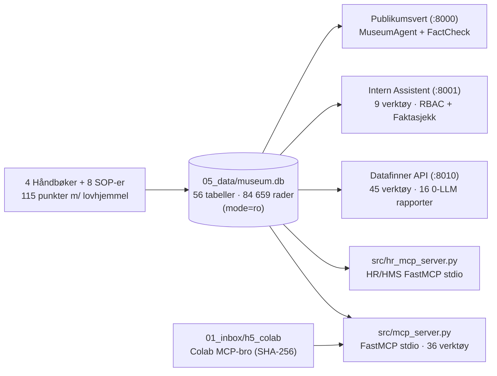

# Kunnskapskart — Hovedportal for Kunstpixel

> **Start her** i Kunnskaps-utforsker (`Les`- eller `Delt`-visning). Alle lenker under åpner tekst-, YAML- og JSON-filene direkte i utforskeren.

---

## 1. Hurtignavigasjon — Kjernefiler

| Område | Fil | Innhold |
| :--- | :--- | :--- |
| **Data- & MCP-oversikt** | [04_knowledge/00_DATA_OG_MCP_OVERSIKT.md](04_knowledge/00_DATA_OG_MCP_OVERSIKT.md) | Komplett tabellkart (`61` brukertabeller / `62` totalt, `92 505` rader), MCP-servere (`37` + `45` + `9` verktøy), porter og Tracer Bullets |
| **Datakart & Relasjonsindeks** | [05_data/index.md](05_data/index.md) | Relasjonsgraf (Mermaid ERD), ID-prefikser, JOIN-stier, formatstandard og komplett katalog over alle `61` brukertabeller |
| **Formål & Gründerkontrakt** | [00_felles/FORMAAL.md](00_felles/FORMAAL.md) | De 4 formålspunktene og samarbeidsmodellen for gründerne |
| **Sentral Begrepsordliste** | [00_felles/ordliste.yaml](00_felles/ordliste.yaml) | Norske definisjoner, lovhjemler og domenekontrakter (vises som filtrerbar tabell) |
| **Agentinstruks & Kommandoer** | [AGENTS.md](AGENTS.md) | Kjørekommandoer, de 7 kritiske reglene (`mode=ro`, `datapolicy`, `fact_check`) og MCP-verktøyliste |
| **Kvalitets- & Internkontroll** | [04_knowledge/01_governance/KVALITETS_OG_STYRINGSSYSTEM.md](04_knowledge/01_governance/KVALITETS_OG_STYRINGSSYSTEM.md) | Myndighetskrav (Arbeidstilsynet, Mattilsynet/HACCP, DSB/Brann, Kommune, Kulturdirektoratet) |
| **Kontekstindeks** | [04_knowledge/04_domain/context_index.yaml](04_knowledge/04_domain/context_index.yaml) | Maskinlesbar indeks over kjernefiler, roller, operasjoner og kontekstkort (`CTX-0001`–`CTX-0004`) |
| **Team & Roller** | [03_team/team_roster.md](03_team/team_roster.md) | Menneskelige roller og AI-agenter på tvers av museet |

---

## 2. Databasen på 30 sekunder (`05_data/museum.db`)

* **Versjon & signatur:** `PRAGMA user_version = 8` · `22 932 KB` · `sha256 = fd4262df266d5fe74d6184998b6cfabc8bd2e3d226c3312586eb81fcb053aaf4`
* **Omfang:** **62 tabeller** (`61` brukertabeller + `sqlite_sequence`) og **92 505 brukerrader** (`2010–2026`). Se [05_data/index.md](05_data/index.md) for relasjonskart og tabellkatalog.
* **Skrivebeskyttelse:** Åpnes alltid med `mode=ro`. Bygges kun via `py -3.13 src/kunstpixel/data/build_museum_db.py` fra `05_data/kilde/museum_base.db` og CSV/JSON/Markdown-kilder.

| Domene | Tabeller | Rader | Nøkkeltabeller (rader) |
| :--- | ---: | ---: | :--- |
| **1. HR, Vaktplan, Tariff & Arbeidsmiljø** | 22 | 60 292 | `hr_vakter` (54 994), `hr_fravaer` (3 456), `org_ansatt_kompetanse` (596), `hr_innleie` (318), `hr_ansatte` (168), `personas` (168), `hr_personalmapper` (167), `hr_medarbeidersamtaler` (142), `virke_tariff` (67) |
| **2. Publikum, Kafé & Besøk** | 6 | 23 322 | `kafe_varesalg` (14 160), `dagsbesok` (6 209), `anmeldelser` (2 040), `besok_tilfredshet` (885), `kafe_meny` (16), `publikum_faq` (12) |
| **3. Samling, Kunstnere & Utstillinger** | 10 | 367 | `utstillinger_historikk` (102), `utstilling_okonomi` (102), `utstillingsinnlan` (50), `hendelser` (45), `verk` (16), `tilstandsrapporter` (16), `kunstnere` (12), `saler` (6) |
| **4. HMS, Styring, Håndbøker & Myndigheter** | 16 | 8 139 | `driftsmeldinger_epost` (3 889), `driftsmeldinger_tiltak` (3 889), `handbok_oppslag` (115), `hms_avvik_tekst` (40), `avvik_hms_drift` (34), `rolle_sporsmal` (31), `rapport_regler` (27), `h5_rapportmaler` (21), `h5_historikk_2010_2026` (17), `roller` (15) |
| **5. Offentlige Registre & Metadata** | 4 | 320 | `norske_helligdager` (237), `ssb_sykefraver_kultur` (68), `leverandor_enhetsregister` (12), `sqlite_sequence` (3) |

Se full tabell-for-tabell-spesifikasjon og relasjonskart i [04_knowledge/00_DATA_OG_MCP_OVERSIKT.md](04_knowledge/00_DATA_OG_MCP_OVERSIKT.md).

---

## 3. MCP-koblinger, API-porter og Morgensløyfe

| Tjeneste / Kanal | Inngangspunkt | Port / Protokoll | Omfang & Sikkerhetsport |
| :--- | :--- | :--- | :--- |
| **Hoved-MCP Server** | `src/mcp_server.py` | `stdio` (FastMCP) | **36 read-only verktøy**: Samling (5), Arkiv/Drift (3), Operativt (6), HR/HMS/Kvalitet (14), Styring/H5 (5), Kart & Colab (3) |
| **HR & HMS MCP Server** | `src/hr_mcp_server.py` | `stdio` (FastMCP) | Dedikert MCP-flate for bemanning, kompetanse, AML kap. 10, STAMI ergonomi og H5-tilsyn |
| **Datafinner & Vaktrom** | `src/kunstpixel/adapters/datafinner_api.py` | `http://127.0.0.1:8010` | **45 hvitelistede verktøy** + **16 0-LLM rapportmaler** (`SPORSMAL`). Valgfritt KI-lag (`/api/forklar`, `/api/chat`) med tallkontroll |
| **Intern Assistent** | `src/kunstpixel/adapters/intern_hub.py` | `http://127.0.0.1:8001` | **9 interne verktøy** (`HMS`, `IK-Mat`, `Brann`, `Tilsyn`, `Rolle`, `Tiltak`, `Myndighet`, `Rapportering`, `Arbeidsoppgaver`) + RBAC |
| **Publikumsvert** | `src/kunstpixel/adapters/chat_hub.py` | `http://127.0.0.1:8000` | Interaktiv museumsvert for besøkende med deterministisk fallback og `fact_check.py` |
| **Morgensløyfe (ADR 014)** | `scripts/informasjonsjeger_kontroll.py` | Cron `09:00–09:45` | `09:00` Informasjonsjeger -> `09:15` Kontrollport/Bygger -> `09:30` Motorbygger -> `09:45` Sentinel |

---

## 4. Virksomhetshåndbøker og Operative Rutiner (`handbok_oppslag` – 115 punkter)

### 4.1 De 4 Virksomhetshåndbøkene (85 punkter)
1. **Personalhåndbok (`PERSONAL` – 27 punkter):** [04_knowledge/01_governance/handboker/01_personalhandbok.md](04_knowledge/01_governance/handboker/01_personalhandbok.md)
   * Ansettelse, prøvetid, arbeidstid (`AML kap. 10`), Virke-tariff, sykefravær/egenmelding, ferie, permisjoner og etikk (`ICOM`).
2. **HMS- og sikkerhetshåndbok (`HMS_SIKKERHET` – 21 punkter):** [04_knowledge/01_governance/handboker/02_hms_sikkerhetshandbok.md](04_knowledge/01_governance/handboker/02_hms_sikkerhetshandbok.md)
   * Internkontroll, vernerunder, ergonomi/rotasjon (`STAMI`), tunge løft (`15/40 kg`), brannvern (`maks 250 pers`), RVR kunstevakuering og førstehjelp.
3. **Drifts- og kvalitetshåndbok (`DRIFT_KVALITET` – 17 punkter):** [04_knowledge/01_governance/handboker/03_drifts_kvalitetshandbok.md](04_knowledge/01_governance/handboker/03_drifts_kvalitetshandbok.md)
   * Åpne-/stengerutiner, konserveringsklima (`18–22 °C / 45–55 % RH`), lysnorm (`50/200 luks`), kasseoppgjør, IK-Mat (`HACCP`), allergener og innlån (`SPECTRUM 5.0`).
4. **Leder- og beredskapshåndbok (`LEDER_BEREDSKAP` – 20 punkter):** [04_knowledge/01_governance/handboker/04_leder_beredskapshandbok.md](04_knowledge/01_governance/handboker/04_leder_beredskapshandbok.md)
   * Lederfullmakter, bemanningsplanlegging, sykefraværsoppfølging (`NAV`), kriseledelse, PLIVO, varsling (`AML kap. 2 A`), anskaffelser (`LOA/FOA`) og tilsyn.

### 4.2 De 8 Operative Rutinene / SOP-ene (`RUTINER_SOP` – 30 punkter)
* **SOP-001 Varsling:** [04_knowledge/02_sops/SOP-001_rutine_varsling.md](04_knowledge/02_sops/SOP-001_rutine_varsling.md)
* **SOP-002 Ferieavvikling:** [04_knowledge/02_sops/SOP-002_rutine_ferie.md](04_knowledge/02_sops/SOP-002_rutine_ferie.md)
* **SOP-003 Fravær & sykefravær:** [04_knowledge/02_sops/SOP-003_rutine_fravaer_og_sykefravar.md](04_knowledge/02_sops/SOP-003_rutine_fravaer_og_sykefravar.md)
* **SOP-004 Vaktbytte:** [04_knowledge/02_sops/SOP-004_rutine_vaktbytte.md](04_knowledge/02_sops/SOP-004_rutine_vaktbytte.md)
* **SOP-005 HMS-avvik & vernerunde:** [04_knowledge/02_sops/SOP-005_rutine_hms_avvik_og_vernerunde.md](04_knowledge/02_sops/SOP-005_rutine_hms_avvik_og_vernerunde.md)
* **SOP-006 Brann & RVR kunstevakuering:** [04_knowledge/02_sops/SOP-006_rutine_brann_og_rvr_kunstevakuering.md](04_knowledge/02_sops/SOP-006_rutine_brann_og_rvr_kunstevakuering.md)
* **SOP-007 IK-Mat, HACCP & allergener:** [04_knowledge/02_sops/SOP-007_rutine_ik_mat_haccp_og_allergener.md](04_knowledge/02_sops/SOP-007_rutine_ik_mat_haccp_og_allergener.md)
* **SOP-008 Åpne-, stenge- & klimatilsyn:** [04_knowledge/02_sops/SOP-008_rutine_apne_stenge_og_klimatilsyn.md](04_knowledge/02_sops/SOP-008_rutine_apne_stenge_og_klimatilsyn.md)

---

## 5. Rolleprompter, Revisjonslinser og Arkitekturbeslutninger (ADR)

### 5.1 Rolleprompter (`04_knowledge/03_prompts/`)
* [MASTERPROMPT_DIGITAL_TVILLING.md](04_knowledge/03_prompts/MASTERPROMPT_DIGITAL_TVILLING.md) · [museumsdirektor.md](04_knowledge/03_prompts/museumsdirektor.md) · [driftsansvarlig.md](04_knowledge/03_prompts/driftsansvarlig.md) · [kurator.md](04_knowledge/03_prompts/kurator.md) · [samlingsforvalter.md](04_knowledge/03_prompts/samlingsforvalter.md) · [formidler.md](04_knowledge/03_prompts/formidler.md) · [museumsvert.md](04_knowledge/03_prompts/museumsvert.md)

### 5.2 Revisjonslinser (`04_knowledge/05_linser/`) og Evalueringsarena (`04_knowledge/07_arena/`)
* **Revisjonslinser:** [00_REVISJONSTEAM_MASTER.md](04_knowledge/05_linser/00_REVISJONSTEAM_MASTER.md) · [01_kvalitetsradgiveren_d5.md](04_knowledge/05_linser/01_kvalitetsradgiveren_d5.md) · [02_hms_radgiveren_d6.md](04_knowledge/05_linser/02_hms_radgiveren_d6.md) · [03_hr_eksperten_f4.md](04_knowledge/05_linser/03_hr_eksperten_f4.md) · [04_forstelinjelederen_l2.md](04_knowledge/05_linser/04_forstelinjelederen_l2.md) · [05_compliance_ansvarlig_p3.md](04_knowledge/05_linser/05_compliance_ansvarlig_p3.md)
* **Evalueringsarena & HR-caser:** [04_knowledge/06_hr_caser/README.md](04_knowledge/06_hr_caser/README.md) · [04_knowledge/07_arena/caser.yaml](04_knowledge/07_arena/caser.yaml) · [04_knowledge/07_arena/chat_eval.yaml](04_knowledge/07_arena/chat_eval.yaml) · [04_knowledge/07_arena/grensecaser.yaml](04_knowledge/07_arena/grensecaser.yaml)

### 5.3 Arkitekturbeslutninger (`ADR_001`–`ADR_014`)
* [decision_log.md](04_knowledge/04_domain/decisions/decision_log.md) — Samlet beslutningslogg
* [ADR_001_helhetlig_operativ_triade.md](04_knowledge/04_domain/decisions/ADR_001_helhetlig_operativ_triade.md) · [ADR_002_samlingsomfang_og_tekststandard.md](04_knowledge/04_domain/decisions/ADR_002_samlingsomfang_og_tekststandard.md) · [ADR_003_hybrid_leverandormodell_brreg.md](04_knowledge/04_domain/decisions/ADR_003_hybrid_leverandormodell_brreg.md) · [ADR_004_konsolidert_database_arkitektur.md](04_knowledge/04_domain/decisions/ADR_004_konsolidert_database_arkitektur.md) · [ADR_005_operativ_hendelses_og_tilstandsmodell.md](04_knowledge/04_domain/decisions/ADR_005_operativ_hendelses_og_tilstandsmodell.md) · [ADR_006_samlingsomfang_og_utstillingsinnlan.md](04_knowledge/04_domain/decisions/ADR_006_samlingsomfang_og_utstillingsinnlan.md) · [ADR_007_offentlige_anskaffelser_og_virke_tariff.md](04_knowledge/04_domain/decisions/ADR_007_offentlige_anskaffelser_og_virke_tariff.md) · [ADR_008_konsolidert_fastmcp_tjeneste.md](04_knowledge/04_domain/decisions/ADR_008_konsolidert_fastmcp_tjeneste.md) · [ADR_009_aml_kap10_arbeidstid_og_hviletid.md](04_knowledge/04_domain/decisions/ADR_009_aml_kap10_arbeidstid_og_hviletid.md) · [ADR_010_offentlige_registre_styrk08_renhold.md](04_knowledge/04_domain/decisions/ADR_010_offentlige_registre_styrk08_renhold.md) · [ADR_011_kalender_sykefraver_og_stami_ergonomi.md](04_knowledge/04_domain/decisions/ADR_011_kalender_sykefraver_og_stami_ergonomi.md) · [ADR_012_virksomhetshandboker_arkitektur.md](04_knowledge/04_domain/decisions/ADR_012_virksomhetshandboker_arkitektur.md) · [ADR_013_internside_hovedversjon_og_ai_oppslag.md](04_knowledge/04_domain/decisions/ADR_013_internside_hovedversjon_og_ai_oppslag.md) · [ADR_014_morgensloyfe_informasjonsjeger_og_funnkontroll.md](04_knowledge/04_domain/decisions/ADR_014_morgensloyfe_informasjonsjeger_og_funnkontroll.md)

---

## 6. Kjent avvik / oppfølging

Rolle-systemprompts i `04_knowledge/03_prompts/` (kurator, formidler, samlingsforvalter, driftsansvarlig, museumsdirektor) bruker en generisk `read_query`/`write_query` SQL-tilgang mot norske tabellnavn (`verk`, `kunstnere`, `saler`...), mens `AGENTS.md` og `README.md` dokumenterer de navngitte FastMCP-verktøyene (`search_collection`, `get_artwork_details`, osv.). Ved endring, husk å bevare read-only skrivebeskyttelse mot databasen.
