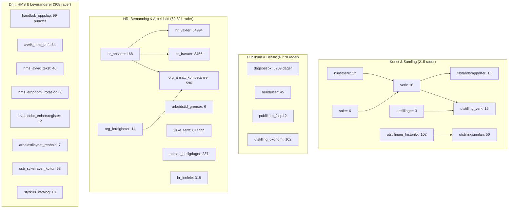
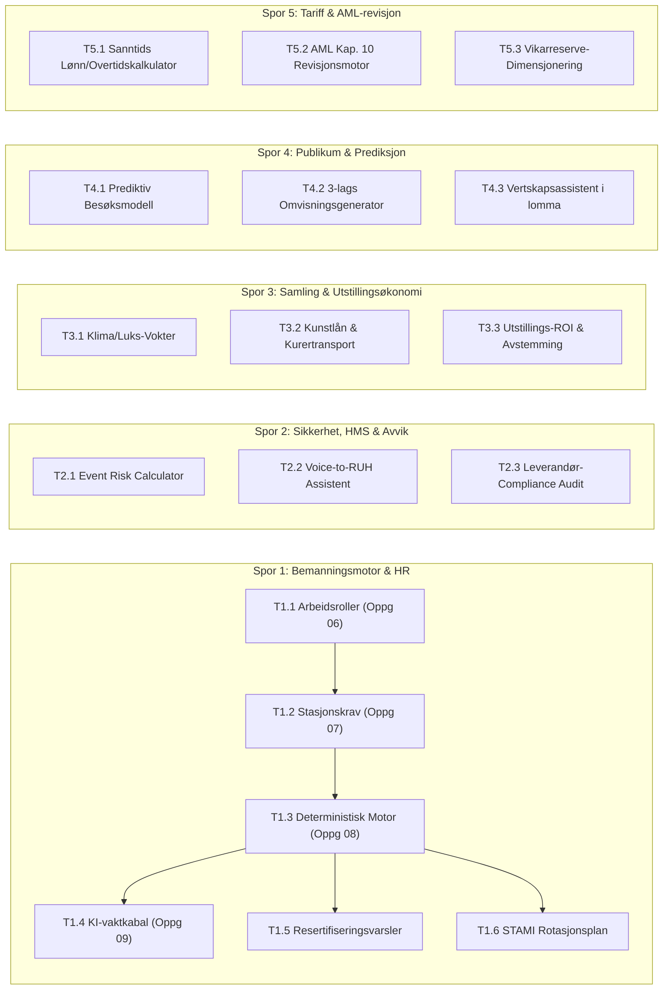

# Datagrunnlag og Oppgavekatalog for Kunstpixel

> **Dokumenttype:** Arkitektur-, data- og oppgaveanalyse  
> **Omfang:** `05_data/museum.db` (40 tabeller, 124 000+ rader), `05_data/*.csv`, `04_knowledge/` og `src/`  
> **Dato:** 24. oktober 2026  
> **Status:** Autoritativ SSOT for datasettets potensial og fremtidig oppgavebygging

---

## 1. Eksekutivt Sammendrag

Kunstpixel-datasettet utgjør en **helhetlig, syntetisk mikromodell av et nasjonalt kunstmuseum** (Aura Kunstmuseum) over 17 fulle driftsår (2010–2026). Det er konstruert med ekstrem intern konsistens, strenge matematiske og juridiske rammebetingelser (AML, Virke-tariff, ICOM-museumsstandarder, STAMI-ergonomi), og dekker samtlige faser av museumsdrift:

- **17 års driftshistorikk:** 6 209 dagers dagsbesøk, 54 994 time-for-time skiftvakter, 3 456 fraværsregistreringer og 102 gjennomførte utstillinger.
- **Dyp organisasjonsmodell:** 168 ansatte, 14 formelle kompetanseområder, 596 sertifiseringer, 67 Virke-lønnstrinn og 237 offisielle helligdager.
- **Samling & formidling:** 16 sentrale verk med 3-lags formidlingstekster (vegg, lyd, barn), 50 eksterne topplån (bl.a. Munch, Kittelsen) med tilstandsgrader og forsikringsverdier opp til 350 MNOK.
- **Drift, HMS & styring:** 74 registrerte avvikshendelser, 99 håndbok- og SOP-paragrafer, 12 Brønnøysund-verifiserte leverandører og 318 innleiekontrakter på over 20 MNOK.

Dette gir et unikt fundament for å bygge **deterministiske, trygge og høytytende agent- og KI-arbeidsflyter** uten risiko for hallusinasjoner eller brudd på personvern og lovverk.

---

## 2. Komplett Inventar over Datagrunnlaget

Databasen `museum.db` (skjemaversjon 4, SQLite i `mode=ro`) inneholder **40 tabeller** fordelt på 6 kjerneområder:



### Detaljert Tabelloversikt

| Domene | Tabellnavn | Rader | Hovedinnhold og nøkkelkolonner |
|---|---|---|---|
| **Samling** | `kunstnere` | 12 | Navn, epoke, nasjonalitet, biografi |
| **Samling** | `verk` | 16 | Tittel, kunstner, teknikk, sal, veggtekst, audioguide, barneformidling |
| **Samling** | `saler` | 6 | Sal A–E og Magasin 1, etasje, tema, klimakontroll, kapasitet |
| **Samling** | `utstillinger` | 3 | Aktive utstillinger (tittel, periode, kurator, saler) |
| **Samling** | `utstilling_verk` | 15 | Mange-til-mange kobling mellom utstilling og utstilte verk |
| **Samling** | `tilstandsrapporter` | 16 | Tilstandsgrad (1–4), luks-grense, klimakrav (RH/temp), forsikringsverdi |
| **Samling** | `utstillinger_historikk` | 102 | 16 års utstillinger (2010–2026), kurator, saler, budsjett, publikumstall |
| **Samling** | `utstillingsinnlan` | 50 | Lån fra Nasjonalmuseet/KODE, 3-lags tekst, kurertransport, forsikring (opptil 350M) |
| **Publikum** | `dagsbesok` | 6 209 | Daglige besøk 2010–2026 fordelt på voksne, studenter, barn, inntekt (133,4 MNOK) |
| **Publikum** | `hendelser` | 45 | Omvisninger, foredrag, verksteder, sal_id, maks deltakere, priser, status |
| **Publikum** | `publikum_faq` | 12 | Autoritativ FAQ for åpningstider, billetter, tilgjengelighet, parkering |
| **Publikum** | `utstilling_okonomi` | 102 | Prosjektregnskap per utstilling (budsjett, innleie, billettinntekt, netto) |
| **HR/Vakt** | `hr_ansatte` | 168 | Anonymiserte ansatte, 74 aktive, stilling, avdeling, lønnstrinn, ansatt_fra/til |
| **HR/Vakt** | `hr_vakter` | 54 994 | Vakter 2010–2026 time-for-time over 10 stasjoner, start/slutt, timer |
| **HR/Vakt** | `hr_fravaer` | 3 456 | Egenmelding, sykmelding, permisjon, ferie med fra/til-datoer |
| **HR/Vakt** | `hr_innleie` | 318 | Innleiekontrakter (vektere, renhold, AV, kurator, transport) på 20+ MNOK |
| **HR/Vakt** | `org_ansatt_kompetanse` | 596 | Sertifiseringer koblet til ansatte med sertifisert_dato og gyldig_til |
| **HR/Vakt** | `org_ferdigheter` | 14 | Ferdighetskatalog (kasse, førstehjelp, brannvern, kunsthåndtering etc.) |
| **HR/Vakt** | `arbeidstid_grenser` | 6 | Lov- og tariffgrenser (37.5t uke, 9t dag, 11t hvile, 48t maks) |
| **HR/Vakt** | `virke_tariff` | 67 | Lønnstrinn 20–86, årslønn, ordinær-, kvelds-, helge- og helligdagstillegg |
| **HR/Vakt** | `norske_helligdager` | 237 | Alle offisielle bevegelige og faste helligdager 2010–2026 (133 % overtid) |
| **HMS/Drift** | `handbok_oppslag` | 99 | Autoritativ tekst fra 4 håndbøker (Personal, HMS, Drift, Beredskap) og 5 SOP-er |
| **HMS/Drift** | `avvik_hms_drift` | 34 | Avvik 2010–2026 med sal, verk, kategori (Klima/HMS/Sikkerhet), strakstiltak |
| **HMS/Drift** | `hms_avvik_tekst` | 40 | Tekstlige HMS-hendelser med stasjon, alvorlighetsgrad og oppfølging |
| **HMS/Drift** | `hms_ergonomi_rotasjon` | 9 | STAMI-krav for stasjoner, maks 2t stående vakt, rotasjonskrav |
| **HMS/Drift** | `leverandor_enhetsregister` | 12 | Brønnøysunddata for nøkkelleverandører (org.form, MVA, ansatte, konkursstatus) |
| **HMS/Drift** | `arbeidstilsynet_renhold` | 7 | Godkjenningsstatus i Arbeidstilsynets register over renholdsvirksomheter |
| **HMS/Drift** | `ssb_sykefraver_kultur` | 68 | Kvartalsvis SSB-fraværsstatistikk (tabell 12441) for kultursektoren |
| **HMS/Drift** | `styrk08_katalog` | 10 | Offisielle SSB STYRK-08 yrkeskoder, minste lønnstrinn og utdanningskrav |
| **Roller** | `personas` | 28 | Dype personakort med utdanning, tidligere arbeidsgivere, publikasjoner |
| **Roller** | `interne_henvendelser` | 60 | Syntetiske interne saker for testing av support og saksbehandling |
| **Roller** | `rapport_regler` | 12 | Valideringsregler for Datafinner-motoren |

---

## 3. Strategisk Oppgaveplan: Hva kan lages av datasettet?

Datasettet er inndelt i **fem strategiske spor** med konkrete, byggbare oppgaver. Hver oppgave har en definert målgruppe, teknisk innretning og forretningsverdi.



---

### Spor 1: Operativ Bemanningsplanlegging & Vikarlogistikk (Kjerne-MVP)

Dette sporet fullfører den vedtatte internsidespesifikasjonen ([`docs/specs/internside-oppslagsverk.md`](file:///g:/Min%20disk/Kunstpixel/docs/specs/internside-oppslagsverk.md)):

#### [T1.1] Arbeidsroller i oppslagsverket (Oppgave 06)
- **Hva:** Koble stillinger og håndbokmålgrupper til 7 faste arbeidsroller (*Salvert, Montør/drift, Kafé, Formidling, Samling/kurator, Leder, Verneombud*).
- **Datasett:** Generere `05_data/arbeidsroller.csv`, `stilling_arbeidsrolle.csv`, `malgruppe_arbeidsrolle.csv`.
- **Verdi:** En vikar eller vert kan filtrere bort alt som ikke angår sin rolle og få lynraskt svar.

#### [T1.2] Kompetansekrav per stasjon (Oppgave 07)
- **Hva:** Etablere en matrise for de 10 stasjonene i `hr_vakter`.
- **Regler:**
  * Kiosk/Resepsjon: Krever `kasse` og `kundeservice`.
  * Museumskafé: Krever `mattrygghet` og `allergen`.
  * Saler (A–E): Krever `brannvern` og `forstehjelp`.
  * Magasin 1: Krever `kunsthandtering` og `kran`.
- **Datasett:** `stasjon_krav.csv`.

#### [T1.3] Deterministisk bemanningsmotor uten KI (Oppgave 08)
- **Hva:** `core/bemanning.py` som tar `(dato, stasjon, start, slutt, behov)` og returnerer egnede kandidater fra de 74 aktive ansatte.
- **Sperrer:**
  * Aktiv i `hr_ansatte` (`status=1`).
  * Ikke registrert fravær i `hr_fravaer`.
  * Ikke allerede på vakt i samme tidsrom i `hr_vakter`.
  * Oppfyller 11 timers sammenhengende hvile etter forrige vakt (AML § 10-8).
  * Har gyldig, ikke-utløpt sertifisering for stasjonens krav (`org_ansatt_kompetanse`).
  * Deterministisk sortering: lavest akkumulert mertid/overtid inneværende måned.

#### [T1.4] KI-forslag til vaktkabaler og vikarinnkalling (Oppgave 09)
- **Hva:** Språkmodell som setter opp forslag til vaktliste for en hel uke eller erstatter akutt sykdom kl. 07:30.
- **Personvern & Guardrail:** LLM-en mottar kun anonymiserte ID-er (`ansatt_id`, stilling, egnethetsflagg) — aldri navn, alder, kjønn eller fraværsårsak (CASE-012/CASE-015). Forslaget valideres av motoren fra T1.3 før det vises for leder.

#### [T1.5] Proaktiv resertifiserings- og kursvarsler
- **Hva:** En daglig monitor som overvåker de 596 sertifiseringene.
- **Logikk:** Førstehjelp (87 ansatte) og Brannvern (62 ansatte) utløper etter 24–36 mnd. Varsler leder 60 dager før utløp og setter automatisk sammen kursgrupper på tvers av avdelinger.

#### [T1.6] STAMI Ergonomisk rotasjonsplanlegger
- **Hva:** Algoritme som tar salvertenes vakter og splitter dem opp i 2-timers intervaller i henhold til `hms_ergonomi_rotasjon` (maks 2t stående vakt i Sal A/B/C/D før rotasjon til resepsjon/kiosk eller pause).

---

### Spor 2: Sikkerhet, HMS & Avvikskontroll

#### [T2.1] Event Risk Calculator (Automatisk risikovurdering ved arrangementer)
- **Hva:** Før en vernissasje eller kveldsomvisning beregnes en samlet risikoprofil.
- **Koblede data:**
  * `hendelser`: Antall deltakere (f.eks. 150 personer i Sal A).
  * `saler`: Salens makskapasitet og rømningsveier.
  * `avvik_hms_drift`: Tidligere hendelser i samme sal (f.eks. `AVV-2026-034` ulåst nødutgang).
  * `utstillingsinnlan`: Forsikringsverdi på verk i salen (f.eks. Munch-verk til 350 MNOK).
- **Output:** Anbefalt antall ekstra vektere fra `hr_innleie`, krav om dedikert brannvakt, og sjekkliste for vaktleder.

#### [T2.2] Voice-to-RUH: Interaktiv avviks- og hendelsesassistent
- **Hva:** Ansatt snakker inn eller skriver kort om en hendelse i appen ("en gjest veltet en kaffekopp nær Nøkken i Sal A").
- **Logikk:** LLM trekker ut entiteter (Sal A, verk `AURA-2026-001`, kategori KLIMA/HMS), slår opp i `tilstandsrapporter` for verket, varsler konservator umiddelbart hvis fukt/søl truer verket, og genererer ferdig RUH-avvik i samsvar med `SOP-001`.

#### [T2.3] Leverandør- og renholds-compliance audit
- **Hva:** Automatisk kontroll av alle innleiekontrakter i `hr_innleie` (318 kontrakter).
- **Logikk:** Verifiserer org.nr mot `leverandor_enhetsregister` (aktiv status, MVA-registrering) og sjekker renholdsbedrifter mot `arbeidstilsynet_renhold` (gyldig godkjenning og HMS-kortkrav). Flagger ulovlige leverandører før faktura godkjennes.

---

### Spor 3: Samling, Konservering & Utstillingsøkonomi

#### [T3.1] Luks- og klimavokter for sårbare mesterverk
- **Hva:** Overvåking av bevaringsforhold for museets 16 faste verk og 50 innlån.
- **Logikk:** Theodor Kittelsens *Nøkken* (`AURA-2026-001`) er pastell/blyant på papir og tåler maks 50 luks og 50% $\pm$ 5% RF. Systemet kryssjekker `tilstandsrapporter` mot loggførte klimaavvik i `avvik_hms_drift` og genererer tiltaksordre ved avvik.

#### [T3.2] Kunstlån- og kurertransportassistent
- **Hva:** Digital samhandlingsflate for innlån fra eksterne museer.
- **Data:** 50 historiske og pågående lån i `utstillingsinnlan`.
- **Funksjon:** Holder oversikt over kurerkrav (klimakasse med sjokklogger), tilstandskontroll ved ankomst og retur, samt automatisk generering av tilstandsprotokoll ved utpakk.

#### [T3.3] Utstillings-ROI og prosjektavstemming (102 utstillinger)
- **Hva:** Økonomisk analyse og benchmarking av museets utstillingshistorikk (2010–2026).
- **Logikk:** Sammenstiller budsjett (`utstillinger_historikk`), innleieutgifter (`hr_innleie`), personalkostnader for vertskap (`hr_vakter` $\times$ `virke_tariff`), og billettinntekter (`dagsbesok` under utstillingsperioden). Beregner netto margin og publikumskostnad per besøkende.

---

### Spor 4: Publikum, Besøksprognoser & Formidling

#### [T4.1] Prediktiv Besøks- og Bemanningsmodell (17 års tidsserie)
- **Hva:** Tidsserieanalyse over de 6 209 dagene i `dagsbesok`.
- **Logikk:** Identifisere sesongsvingninger, helgeeffekter, ferie-topper (`norske_helligdager`) og korrelasjon med utstillingstemaer.
- **Anvendelse:** Forutsi neste ukes besøkstall og automatisk foreslå nødvendig vertsbemanning i resepsjon og kafé (f.eks. oppskalering fra 2 til 5 verter på regnfulle høstlørdager).

#### [T4.2] 3-lags Omvisningsgenerator (Publikumsvert 2.0)
- **Hva:** Autonom formidlingsagent basert på de strukturerte 3-lags tekstene i `verk` og `utstillingsinnlan`.
- **Ruter:**
  1. *Barne- og familieruten:* Benytter `barneformidling`-tekstene for interaktive oppgaver og spennende historier om Nøkken og troll.
  2. *Hurtigrunden (30 min):* Konsentrerer seg om høydepunkter i Sal A og Sal D (Kittelsen og Munch).
  3. *Dybdeformidling / Audioguide:* Bruker `audioguide_manus` og historiske proveniensdetaljer.

#### [T4.3] Salvertens digitale lommeassistent
- **Hva:** En mobiloptimalisert utgave av `oppslag.html` skreddersydd for vertene som patruljerer salene.
- **Funksjoner:** Lynraske svar på vanlige publikumsspørsmål (`publikum_faq`: HC-heis, toaletter, barnevogn, fotografering med blits) samt beredskapsstøtte ved evakuering eller akutt sykdom blant publikum.

---

### Spor 5: Tariff, Arbeidstidsrevisjon & Compliance (Kategori C)

#### [T5.1] Sanntids Skift- og Lønnskalkulator (Virke Landsoverenskomst)
- **Hva:** Kalkulator som regner ut eksakte lønnskostnader for enhver vakt eller periode.
- **Komponenter:**
  * Lønnstrinn 20–86 i `virke_tariff`.
  * Ordinær timesats.
  * Kveldstillegg (etter kl. 17.00 og etter kl. 21.00).
  * Lørdags- og søndagstillegg.
  * 133 % overtidstillegg på de 237 offisielle helligdagene i `norske_helligdager`.
- **Bruk:** Økonomisk forhåndskalkyle før vaktplaner godkjennes, og kontroll av fakturerte timer fra innleide vektere.

#### [T5.2] AML Kapittel 10 Revisjonsmotor
- **Hva:** Automatisk revisjonsprogram som scanner samtlige 54 994 vakter i `hr_vakter` for systemiske lovbrudd.
- **Rapporterer:**
  * Brudd på § 10-8 (11 timers daglig sammenhengende hvile).
  * Brudd på § 10-4 (arbeidstid utover 9 timer per døgn eller 37,5/40 timer per uke).
  * Søndagsarbeid i strid med § 10-10.
- **Målgruppe:** Ledelse og tillitsvalgte ved den årlige internkontrollgjennomgangen (`LEDER_BEREDSKAP-10.1`).

#### [T5.3] Vikarreserve-faktor og sykefraværsanalyse
- **Hva:** Analyse av museets 3 456 fraværstilfeller mot SSBs offisielle referansetall (`ssb_sykefraver_kultur` for 68 kvartaler).
- **Output:** Beregner den matematisk optimale vikarreserven for museet for å unngå overtid og innleiekostnader ved sesongtopper og influensaepidemier.

---

## 4. Prioritert Handlingsplan og Neste Steg

For de to gründerne bak Kunstpixel anbefales følgende sekvensielle gjennomføring:

```text
Fase 1: Fullføre MVP for Internsiden (Nå)
  ├── 1. Bekrefte og bygge Oppgave 06 (Arbeidsroller & Målgruppefiltrering)
  ├── 2. Etablere Oppgave 07 (Kompetansekrav per stasjon)
  ├── 3. Implementere Oppgave 08 (Deterministisk bemanningsmotor for vakt og vikar)
  └── 4. Koble på Oppgave 09 (KI-forslag med AML-garanti)

Fase 2: Drift, Sikkerhet & Kategori C (Neste sprint)
  ├── 5. Etablere Event Risk Calculator (T2.1 for vernissasje og kveldsarrangement)
  ├── 6. Iverksette proaktiv resertifiseringsvarsler (T1.5 for førstehjelp og brannvern)
  └── 7. Kjøre full AML Kap. 10 revisjonsrapport over alle vakter (T5.2)

Fase 3: Samling & Publikumsformidling (Vekstfase)
  ├── 8. Lansere 3-lags omvisningsgenerator i vertens lommeassistent (T4.2 & T4.3)
  └── 9. Utstillings-ROI analyse over de 102 historiske utstillingene (T3.3)
```

---

> [!TIP]
> Alt underlag er 100 % lokalt, ferdig vasket og syntetisk merket (`mode=ro`). Det kan trygt kjøres og analyseres av eksterne modeller og lokale Python-skript uten kostnad eller personvernrisiko.
